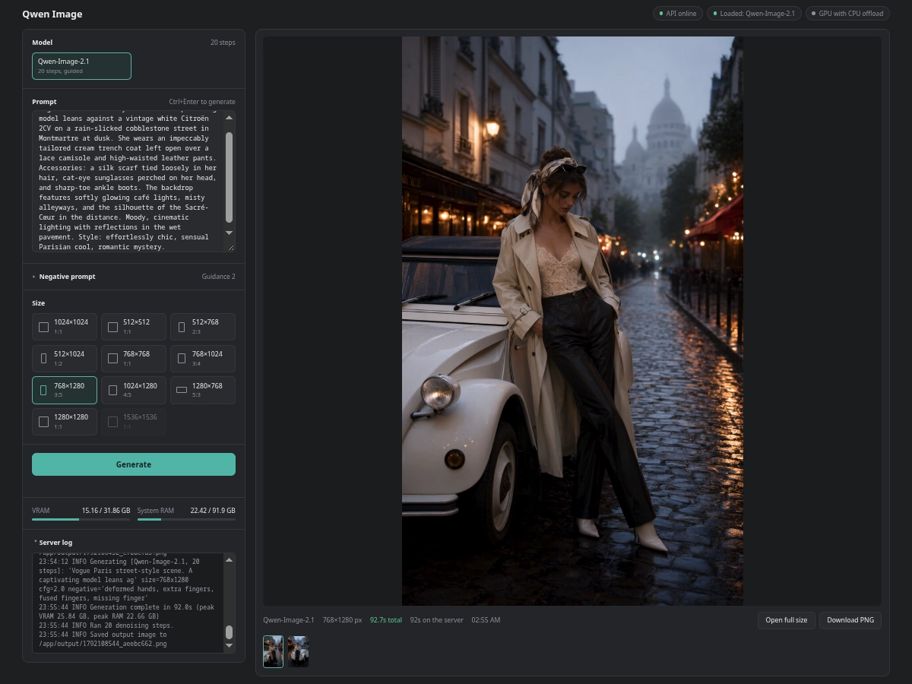
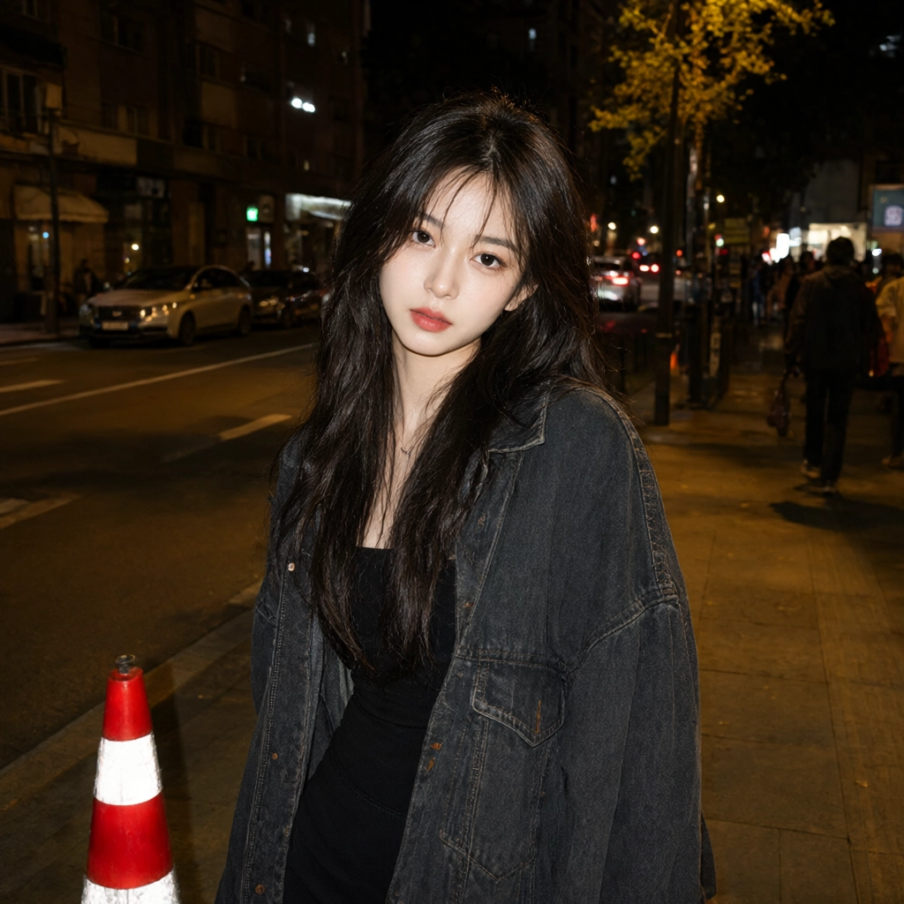
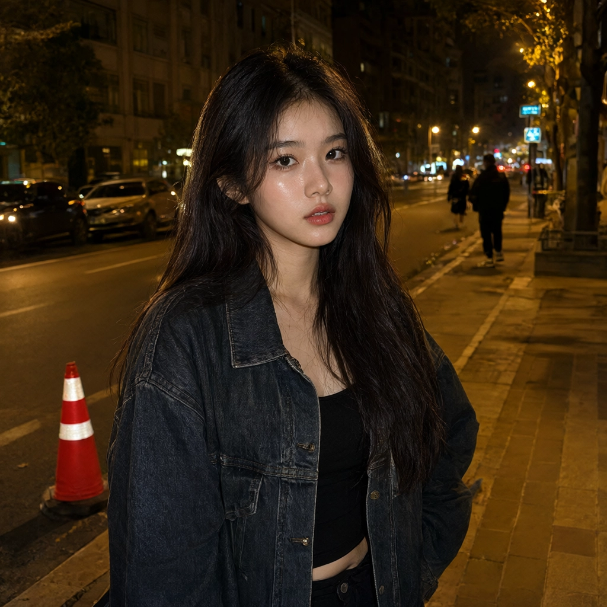
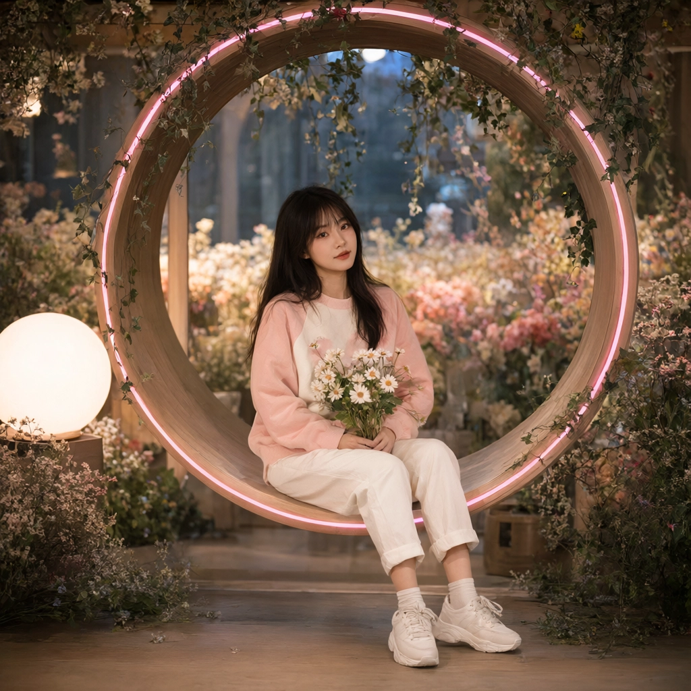

# Qwen Image API

A self-hosted image generation API powered by Qwen-Image-2.1 and Qwen-Image-2.1-Turbo,
running on AMD ROCm (tested on an AMD Radeon AI PRO R9700, 32GB VRAM). Exposes an
OpenAI-compatible `/v1/images/generations` endpoint, plus a minimal web UI for
prompting without curl.

## Architecture

```
┌──────────────────────┐      ┌─────────────────────────┐
│  qwen-image-ui       │      │  qwen-image-api         │
│  (nginx, :3000)      │────▶│  (FastAPI, :8000)       │
└──────────────────────┘      │  Qwen-Image-2.1         │
                              └─────────────────────────┘
┌──────────────────────┐      ┌─────────────────────────┐
│  qwen-image-turbo-ui │      │  qwen-image-turbo-api   │
│  (nginx, :3001)      │────▶│  (FastAPI, :8001)       │
└──────────────────────┘      │  Qwen-Image-2.1-Turbo   │
                              └─────────────────────────┘
```

- **`qwen-image-api`** — FastAPI server wrapping the diffusers `QwenImage21Pipeline`
  for the base model. Code lives in `server/`, split into `main.py` (routes),
  `pipeline.py` (model loading/quantization), `monitoring.py` (logs, GPU/RAM stats,
  memory warnings), `config.py` (settings) and `schemas.py` (request models).
- **`qwen-image-turbo-api`** — the same server code in its own container, serving
  only Turbo. It has its own `Dockerfile.turbo`, `config.turbo.yaml` and output
  folder.
- **`qwen-image-ui`** / **`qwen-image-turbo-ui`** — the same static `web/index.html`
  served by nginx. Opened on `:3000` it talks to the base API, opened on `:3001`
  it talks to the Turbo API. No build step, no framework.

See `CLAUDE.md` for AI-assistant-facing context and `docs/PITFALLS.md` for the
list of issues we've already debugged — check there before re-diagnosing
something from scratch.

## Quickstart

```bash
# One-time setup per machine: create local folders and machine-specific identity
mkdir -p models output output-turbo cache/miopen
echo "UID=$(id -u)" > .env
echo "GID=$(id -g)" >> .env
echo "RENDER_GID=$(getent group render | cut -d: -f3)" >> .env

# 1. Populate models/ — see docs/MODEL_SETUP.md for the full download steps
# 2. Build and start everything
docker compose up -d --build

# 3. Open a UI
# http://localhost:3000  (base model)
# http://localhost:3001  (Turbo)

# 4. Or hit an API directly (port 8001 for Turbo)
curl -X POST http://localhost:8000/v1/images/generations \
  -H "Content-Type: application/json" \
  -d '{"prompt": "a red fox sitting in a snowy forest", "size": "1024x1024"}'
```

Create `output-turbo` yourself (the `mkdir` above does it). If Docker creates it,
it ends up owned by root and the container can't save images into it.

First generation after a fresh build will be slower than usual — the model loads
and MIOpen tunes its kernel cache for your specific GPU on first run, then reuses
it afterward (see `docs/PITFALLS.md`).

Both models share one GPU. A loaded model stays in VRAM until its container stops,
so stop one API before using the other (`docker compose stop qwen-image-api`).

## Using the web UI



*(Screenshot converted to WebP with `cwebp screenshot.png -o docs/images/ui-screenshot.webp -q 100`)*

1. Type a prompt in the text box. Your prompt is remembered across refreshes.
2. Pick a size.
3. Click **Generate** (or press Ctrl+Enter) — a progress overlay shows the current
   step, elapsed time and an estimated time left, and the side panel shows live
   VRAM/RAM usage and the server log.
4. The finished image appears on the right with the total time taken. Use
   **Download PNG** to save it. Your last few images stay in a strip below it
   until you close the tab.

The negative prompt box only has an effect when guidance is turned on in the config
(see below).

## Configuration

Most tunable settings live in `config.yaml` (base) and `config.turbo.yaml` (Turbo)
in the project root, and apply on container restart — no rebuild needed:

```yaml
memory:
  run_on_ram: false          # true = run everything on the CPU (works, but very slow)
  quantize_transformer: true # int8 weights to save VRAM; false = plain bf16
  gpu_max_memory: "16GiB"    # VRAM budget for pipeline component placement
  cpu_max_memory: "40GiB"    # RAM budget for whatever doesn't fit on GPU

generation:
  total_steps: 40            # denoising steps — higher = better quality, slower
  true_cfg_scale: 1.0        # 1.0 = guidance off (recommended for Qwen-Image-2.1)
  negative_prompt: ""        # only used when true_cfg_scale is above 1
  max_pixels: 1638400        # requests above this (width × height) are rejected

monitoring:
  vram_warn_percent: 92      # warn when usage passes these
  ram_warn_percent: 90
```

- **`gpu_max_memory`** controls which pipeline components (transformer, text
  encoder, VAE) get placed on GPU vs. spilled to CPU RAM at load time. It does
  *not* cap runtime memory during generation — that scales with resolution, which
  is what `max_pixels` guards against. Counterintuitively, a **lower**
  `gpu_max_memory` can enable **larger** images: fewer resident weights leaves
  more of the card free for the activation spike during denoising and VAE decode.
- **`total_steps`** is passed straight to the pipeline as `num_inference_steps`.
  Turbo is distilled for **8 steps** (its schedule is stored in the checkpoint),
  so leave it at 8 in `config.turbo.yaml`.
- **`true_cfg_scale`** should stay at `1.0`. Qwen-Image-2.1 is designed to run
  without guidance, and high values made images worse. Anything above 1 also
  makes each step roughly twice as slow.
- **`max_pixels`** rejects oversized requests with a clean `400` before they reach
  the GPU, instead of risking an uncontrolled VRAM spike.
- **`run_on_ram`** is a fallback for when something won't fit on the GPU.
  Expect many minutes per image.
- **Models:** each config has a `models:` section with a `path`, a `label` and
  optional per-model `total_steps` / `true_cfg_scale`. Setting `enabled: false` on
  a model removes it from that container. By default each container serves one model.

```bash
nano config.yaml
docker compose restart qwen-image-api
```

A few settings aren't config-driven and still live in `server/pipeline.py`:

- **`quant_mapping`** — which components run in int8 (only the transformer
  currently). Trades VRAM for image fidelity — see `docs/PITFALLS.md`.
- **`pipe.vae.enable_slicing()`** — cheap memory optimization, minimal quality
  cost. Keep enabled.
- **`pipe.vae.enable_tiling()`** — currently disabled. It caused visible seam
  artifacts — only re-enable if you hit VAE-decode OOM and can't free VRAM
  another way.

Request fields (`server/schemas.py`):

- **`prompt`** — required.
- **`size`** — default `"1024x1024"`, passed straight through as width × height.
- **`negative_prompt`** — optional, uses the configured default when omitted.
- **`model`** — optional, defaults to the container's default model.
- **`n`, `response_format`** — unused placeholders, present for OpenAI API
  compatibility, not implemented.

The response contains the image as base64 PNG in `data[0].b64_json`. A `409` means
another image is already being generated, and a `503` means the GPU or RAM ran out
of memory.

## Monitoring

The server watches memory while it works. When VRAM or RAM passes the thresholds in
the config, a warning shows up in the log and as a banner in the UI. If a generation
runs out of memory, the log records how much VRAM and RAM were in use at the time and
what to try next, and the API answers with a `503` instead of crashing.

After each image the log shows how long it took, the peak VRAM and RAM, and
`Ran N denoising steps.` At startup it prints the torch, diffusers and transformers
versions. `GET /status` returns the same information as JSON.

## Docs

- `config.yaml`, `config.turbo.yaml` — settings, edit and restart to apply
- `CLAUDE.md` — context for AI assistants working on this repo
- `docs/PITFALLS.md` — bugs we've hit, root causes, fixes (read before debugging)
- `docs/COMMANDS.md` — docker + git command reference
- `docs/MODEL_SETUP.md` — how to (re)populate `models/` from scratch

## Example output


```
Night street portrait of a stylish young woman with long dark hair wearing a loose dark denim jacket and black top, standing on a city sidewalk beside a red and white traffic cone, direct camera flash illuminating her face and jacket, glossy skin highlights, warm yellow streetlights and cars in the background, softly blurred urban buildings and pedestrians, cinematic nighttime atmosphere, street photography style, high detail, realistic lighting, 35mm flash photography, shallow depth of field.
```

```
Fashion editorial portrait of a young European woman in her twenties sitting confidently in a plush over-sized pink faux-fur armchair against a soft pastel pink background; she wears a fluffy pink jacket, white trousers and white lace-up boots, seated with legs crossed and a calm confident expression; surrounded symmetrically by multiple fluffy long-haired cats in cream, gray and white tones perched on the chair arms, backrest and floor around her; highly stylized monochromatic pink aesthetic, soft studio lighting, clean background, luxurious textures in fur fabric and cat fur, centered composition, fashion magazine style, high detail, shallow depth of field, ultra-sharp textures, high dynamic range, 8k ultra-photorealism, masterpiece quality.
```

```
A professional full-body shot of a person sitting gracefully inside a large circular wooden frame ringed with a soft pink neon glow, holding a small bouquet of daisies in their lap. The person wears a cozy pastel pink and white sweatshirt, white pants, white socks, and chunky white sneakers. The setting is a cozy indoor floral sanctuary, decorated with hanging green ivy and delicate blossoms, with a round glowing white globe lamp on the left casting warm, diffused light. The background is filled with blurred colorful flowers, creating a soft dreamy bokeh effect with cinematic lighting.
```
