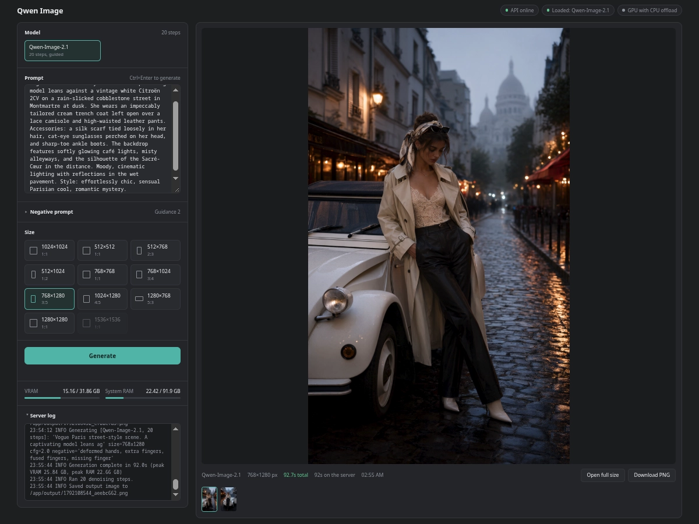
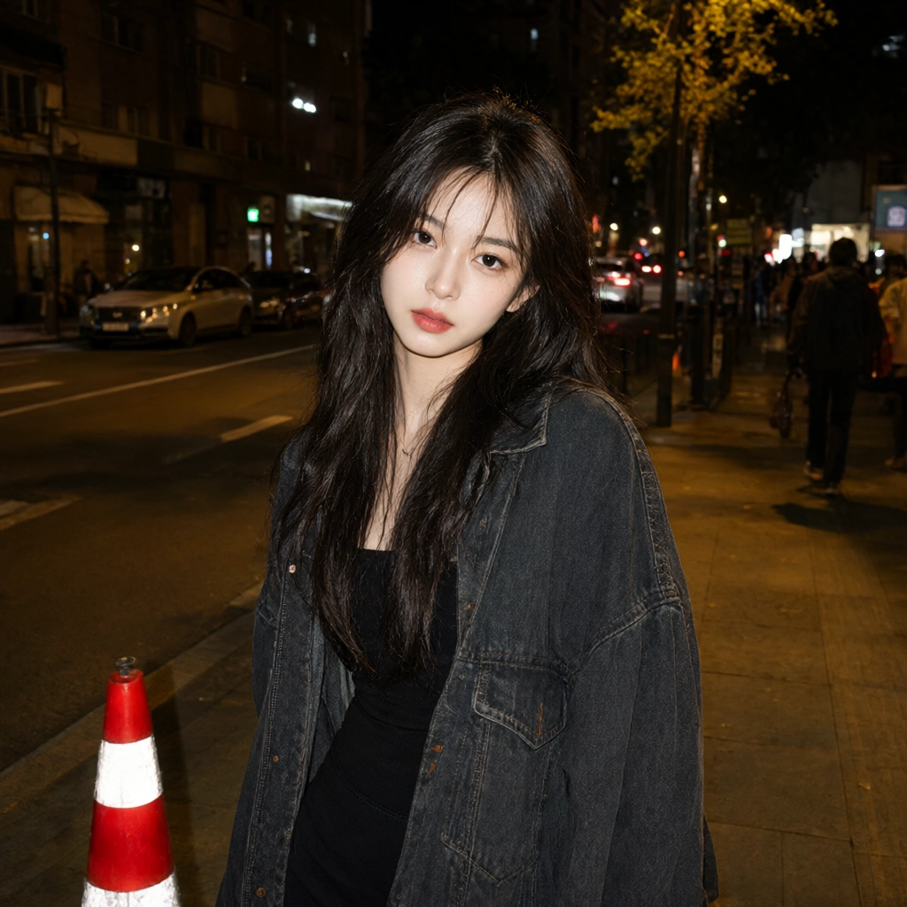
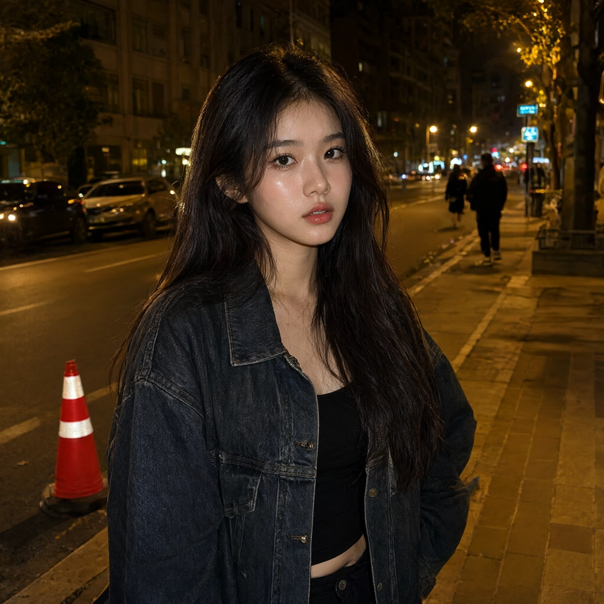

# Qwen Image API

A self-hosted image generation and editing server for Qwen-Image-2.1 and
Qwen-Image-2.1-Turbo, running on AMD ROCm (tested on an AMD Radeon AI PRO R9700,
32GB VRAM).

- **Create**: text to image, OpenAI-style `POST /v1/images/generations`.
- **Edit**: instruction editing with 1–4 reference images ("Change the background to a
  sunset beach"), `POST /v1/images/edits`. Qwen-Image-2.1 is a unified generation and
  editing model, so this is the model's own editing, not a workaround.
- **Gallery**: every image in `output/` with its per-generation log.
- **MCP server** at `/mcp`, so agents can generate, edit and check status.
- Live VRAM/RAM monitoring, OOM detection, and a log file for every job.

## Architecture

```
┌──────────────────────┐      ┌──────────────────────────┐
│  qwen-image-ui       │      │  qwen-image-api          │
│  (nginx, :5008)      │────▶│  (FastAPI, :8000, /mcp)  │
└──────────────────────┘      │  Qwen-Image-2.1          │
                              └──────────────────────────┘
┌──────────────────────┐      ┌──────────────────────────┐
│  qwen-image-turbo-ui │      │  qwen-image-turbo-api    │
│  (nginx, :5009)      │────▶│  (FastAPI, :8001, /mcp)  │
└──────────────────────┘      │  Qwen-Image-2.1-Turbo    │
                              └──────────────────────────┘
```

- **`qwen-image-api`**: FastAPI server wrapping the diffusers `QwenImage21Pipeline` for
  the base model. Code lives in the `server/` package (see "Code layout" below).
- **`qwen-image-turbo-api`**: the same server code in its own container, serving only
  Turbo, with its own `Dockerfile.turbo`, `config.turbo.yaml` and `output-turbo/` folder.
- **`qwen-image-ui`** / **`qwen-image-turbo-ui`**: the same static UI (`web/`) served by
  nginx. Opened on `:5008` it talks to the base API, opened on `:5009` to the Turbo API.
  No build step, no framework.

See `CLAUDE.md` for AI-assistant-facing context and `docs/PITFALLS.md` for the issues
already debugged; check there before re-diagnosing something from scratch.

## Quickstart

```bash
# One-time setup per machine: create local folders and machine-specific identity
mkdir -p models output output-turbo cache/miopen
echo "UID=$(id -u)" > .env
echo "GID=$(id -g)" >> .env
echo "RENDER_GID=$(getent group render | cut -d: -f3)" >> .env

# 1. Populate models/ (see docs/MODEL_SETUP.md)
# 2. Make sure nginx can read the UI files
chmod -R a+rX web
# 3. Build and start everything
docker compose up -d --build

# 4. Open a UI
# http://localhost:5008  (base model)
# http://localhost:5009  (Turbo)

# 5. Or call an API directly (port 8001 for Turbo)
curl -X POST http://localhost:8000/v1/images/generations \
  -H "Content-Type: application/json" \
  -d '{"prompt": "a red fox sitting in a snowy forest", "size": "1024x1024"}'
```

Create `output-turbo` yourself (the `mkdir` above does it). If Docker creates it, it
ends up owned by root and the container can't save images into it.

The first generation after a fresh build is slower: the model loads and MIOpen tunes
its kernel cache for your GPU, then reuses it (see `docs/PITFALLS.md`).

Both models share one GPU. A loaded model stays in VRAM until its container stops, so
stop one API before using the other (`docker compose stop qwen-image-api`).

## Using the web UI

The menu on the left has **Create** and **Edit** at the top and a big **Gallery** button
under them. The view is kept in the URL (`#create`, `#edit`, `#gallery/<id>`), so a
refresh or the browser's Back button keeps you where you were. The page title says
"Qwen Image Turbo" when it is talking to the Turbo API.



*(Screenshot from before the Edit/Gallery update.)*

**Create**
1. Type a prompt. It is remembered across refreshes. Put exact text to render in quotes.
   **Transparent background** adds the model's wording for a transparent (RGBA) PNG.
2. Pick a size (multiples of 32; sizes over `max_pixels` are greyed out).
3. **Generate** (or Ctrl+Enter). The overlay shows the step, elapsed time and time left;
   the menu shows live VRAM/RAM and the server log.
4. The result shows its seed (click to reuse) and can be downloaded, opened full size,
   or sent to Edit with **Edit this**. Your last images stay in a strip below it.

**Edit**
1. Add 1–4 images: drop, paste (Ctrl+V), choose files, or use **Edit this** on a result
   or in the Gallery. They are numbered Picture 1, Picture 2, … Transparency is kept.
2. Write an instruction: "Change the background to a sunset beach", "Make the jacket
   red", "Put the product from Picture 1 on the table in Picture 2". What you don't
   mention is kept.
3. **Output size**: *Auto* keeps the last image's aspect ratio at about 1 MP; or pick a size.
4. **Edit image**. **Compare** flips between the result and the last reference (hold to peek).

**Gallery**: all images in `output/` (or `output-turbo/`), newest first. Select one to
see it full size with its `output/logs/<id>.log` below, its reference images if it was
an edit, **Reuse settings** (prompt, seed, size, references back into Create/Edit) and
**Edit this image**. Images made before this update have no log; the gallery says so.

Under **Advanced** you can override steps (not for Turbo: its 8 steps are fixed), CFG and
seed for one run. The negative prompt is only used when CFG is above 1.

## Configuration

Most tunable settings live in `config.yaml` (base) and `config.turbo.yaml` (Turbo) in
the project root, and apply on container restart (no rebuild needed):

```yaml
memory:
  run_on_ram: false          # true = run everything on the CPU (works, but very slow)
  quantize_transformer: true # int8 weights to save VRAM; false = plain bf16
  vae_fp32: false            # run the VAE in float32 (try it if you see fine lines)
  vae_on_cpu: false          # run the VAE on the CPU, from system RAM (for big sizes)
  gpu_max_memory: "16GiB"    # VRAM budget for pipeline component placement
  cpu_max_memory: "40GiB"    # RAM budget for whatever doesn't fit on GPU

generation:
  total_steps: 40            # denoising steps; higher = better quality, slower
  true_cfg_scale: 1.0        # 1.0 = guidance off (recommended for Qwen-Image-2.1)
  negative_prompt: ""        # only used when true_cfg_scale is above 1
  max_pixels: 1638400        # requests above this (width × height) are rejected

edit:
  max_images: 4              # reference images per edit (the model supports 10)
  resolution: 1024           # references and auto-size edits at about this side²
  max_upload_mb: 25

server:
  public_url: http://localhost:8000   # base of image links (Turbo: :8001)

mcp:
  enabled: true
  name: qwen-image           # Turbo: qwen-image-turbo
  allowed_hosts: []          # extra hosts allowed to reach /mcp besides localhost

monitoring:
  vram_warn_percent: 92      # warn when usage passes these
  ram_warn_percent: 90
```

- **`gpu_max_memory`** controls which pipeline components (transformer, text
  encoder, VAE) get placed on GPU vs. spilled to CPU RAM at load time. It does
  *not* cap runtime memory during generation — that scales with resolution, which
  is what `max_pixels` guards against. Counterintuitively, a **lower**
  `gpu_max_memory` can enable **larger** images: fewer resident weights leaves
  more of the card free for the activation spike during denoising and VAE decode.
- **`total_steps`** is passed to the pipeline as `num_inference_steps`. Turbo is
  distilled for **8 steps** and its schedule is stored in the checkpoint
  (`model_index.json`: `sample_sigmas`), which always wins: Turbo runs 8 steps whatever
  `total_steps` says, and the API reports 8.
- **`true_cfg_scale`** should stay at `1.0`. Qwen-Image-2.1 is designed to run
  without guidance, and high values made images worse. Anything above 1 also
  makes each step roughly twice as slow.
- **`max_pixels`** rejects oversized requests with a clean `400` before they reach
  the GPU, instead of risking an uncontrolled VRAM spike.
- **`run_on_ram`** is a fallback for when something won't fit on the GPU.
  Expect many minutes per image.
- **`vae_fp32`** makes the VAE decode in float32 instead of bf16. It can remove
  fine banding or line artifacts, at the cost of extra VRAM during the last step.
- **`vae_on_cpu`** keeps the VAE in system RAM and runs it on the CPU: the final
  decode, and for edits also the encoding of the reference images. Use it if a large
  size runs out of VRAM during the last step. Only those VAE passes get slower; the
  denoising still runs on the GPU. Don't combine it with `vae_fp32`
  on the GPU: float32 doubles the decode memory and can cause that out-of-memory
  error in the first place.
- **`edit.max_images`** caps reference images per edit (default 4; the model supports
  10). Every image adds tokens to the sequence, so more images cost VRAM and time.
- **`edit.resolution`** (default 1024): references are resized to about this side
  length squared, and an edit without a size comes out at about that area.
- **Models:** each config has a `models:` section with a `path`, a `label` and
  optional per-model `total_steps` / `true_cfg_scale`. Setting `enabled: false` on
  a model removes it from that container. By default each container serves one model.

Every key has a built-in default, so a config without the newer sections (`edit`,
`server`, `mcp`) still works.

```bash
nano config.yaml
docker compose restart qwen-image-api
```

A few settings aren't config-driven and live in `server/engine/qwen.py`:

- **`quant_mapping`**: which components run in int8 (only the transformer). Trades VRAM
  for image fidelity (see `docs/PITFALLS.md`).
- **`pipe.vae.enable_slicing()`**: cheap memory optimization, minimal quality cost. Keep it.
- **`pipe.vae.enable_tiling()`**: disabled. It caused visible seam artifacts; only
  re-enable if you hit VAE OOM and can't free VRAM another way.

## API

All endpoints return JSON errors as `{"detail": "..."}`: `400` bad input, `404` unknown
image, `409` another job is running (one at a time), `503` out of memory (GPU or RAM).
Ports: base `8000`, Turbo `8001`.

### `POST /v1/images/generations`

JSON body: `prompt` (required), `size` (`"1024x1024"`, multiples of 32), `model`,
`steps` (not for Turbo), `true_cfg_scale` (1 = off), `negative_prompt` (only with CFG on),
`seed` (random when omitted), `response_format` (`b64_json` default, or `url`), `n` (must be 1).

Response: `data[0].b64_json` (or `data[0].url`), `id`, `file`, `model`, `seed`, `size`,
`generation_seconds`, `steps_ran`. The PNG is saved as `output/<id>.png` and the log as
`output/logs/<id>.log`.

### `POST /v1/images/edits`

Same fields, a prompt that is an instruction, an optional `size` (omit for Auto), and
1–4 reference images in order (Picture 1, 2, …):

```bash
# multipart upload (OpenAI style); repeat -F image=@... for more pictures
curl -X POST http://localhost:8000/v1/images/edits \
  -F image=@photo.jpg -F prompt="Change the background to a sunset beach"

# JSON: an ordered list mixing base64 / data URLs and images already in output/
curl -X POST http://localhost:8000/v1/images/edits -H "Content-Type: application/json" -d '{
  "prompt": "Put the mug from Picture 1 on the table in Picture 2",
  "images": [{"source": "1761234567_ab12cd34"}, {"data": "data:image/png;base64,iVBOR..."}]}'

# shortcuts for one image: "image": "<base64>" or "source": "<id>"
```

The response adds `reference_images`. The references are kept as
`output/sources/<id>_<n>.png`.

### Gallery and status

| Endpoint | Returns |
|---|---|
| `GET /v1/gallery?offset=0&limit=60` | Images in `output/`, newest first, with prompt preview and status. |
| `GET /v1/gallery/{id}` | One image's parameters, prompt, full log text and reference image URLs. |
| `GET /v1/gallery/{id}/image` · `/thumb` · `/source/{n}` · `/log` | The PNG, a cached JPEG thumbnail, edit reference n, the log as text. |
| `GET /status` | Busy flag, phase, progress, loaded model, VRAM/RAM, warnings, recent log lines. |
| `GET /config` | Sizes, models (with their real step counts), edit limits. |
| `GET /health` | `{"ok": true}` without touching the GPU. |

Interactive API docs: http://localhost:8000/docs

## MCP server

Each API also serves MCP (streamable HTTP): **`http://localhost:8000/mcp`** (base,
server name `qwen-image`) and **`http://localhost:8001/mcp`** (Turbo, `qwen-image-turbo`),
with tools `generate_image`, `edit_image`, `get_status`, `get_options`, `list_images` and
`get_image`. Clients that take a URL connect directly; command-only hosts such as Bionic
use the bundled bridge (`tools/mcp_stdio_bridge.py`, standard library only). Setup,
tool reference and troubleshooting: **`docs/MCP.md`**.

## Monitoring

When VRAM or RAM passes the thresholds in the config, a warning shows up in the log and
as a banner in the UI. If a job runs out of memory, the log records the VRAM and RAM in
use and what to try next, and the API answers `503` instead of crashing. After each job
the log shows the time taken, peak VRAM and RAM, and `Ran N denoising steps.` At startup
it prints the torch, diffusers and transformers versions.

## Development and tests

```bash
pip install -r requirements-dev.txt
pytest                         # ~180 tests, seconds, no GPU / model / torch needed
python tests/mock_server.py    # real API + UI + MCP, fake model: http://localhost:3102/?api=8102
```

Tests run the real FastAPI app through `TestClient` with a mock engine, temporary config
and output folders, and checked-in synthetic fixtures (`tests/fixtures/`). With CPU torch
and diffusers installed, `tests/test_engine_wiring.py` also checks the engine and the VAE
placement against diffusers' real classes. For a check on the real model and GPU, follow
`docs/SMOKE_TEST.md`.

### Code layout

```
server/
  app.py          create_app(): wiring, routes, MCP, startup
  settings.py     config.yaml + defaults -> Settings (reads Turbo's saved schedule)
  service.py      validation, one job at a time, PNG + log per job
  engine/qwen.py  loads Qwen-Image-2.1, memory options, generate, edit
  imaging.py      uploads, edit sizing, PNG/thumbnail encoding
  storage.py      output/ files, logs, gallery listing
  monitoring.py   logging, progress, GPU/RAM stats, OOM detection
  routes/         HTTP endpoints (images, gallery, system)
  mcp_server.py   MCP tools
```

Editing `server/` needs `docker compose up -d --build qwen-image-api` (and/or
`qwen-image-turbo-api`); a config change only a restart; `web/` only a browser refresh.

## Docs

- `config.yaml`, `config.turbo.yaml`: settings, edit and restart to apply
- `CLAUDE.md`: context for AI assistants working on this repo
- `docs/PITFALLS.md`: bugs we've hit, root causes, fixes (read before debugging)
- `docs/COMMANDS.md`: docker, testing and git command reference
- `docs/MODEL_SETUP.md`: how to (re)populate `models/` from scratch
- `docs/MCP.md`: the MCP server
- `docs/SMOKE_TEST.md`: manual check on the real model
- `skills/`: agent skills (`qwen-image-api-internals`, `qwen-image-api-mcp`)

## Example output


```
Night street portrait of a stylish young woman with long dark hair wearing a loose dark denim jacket and black top, standing on a city sidewalk beside a red and white traffic cone, direct camera flash illuminating her face and jacket, glossy skin highlights, warm yellow streetlights and cars in the background, softly blurred urban buildings and pedestrians, cinematic nighttime atmosphere, street photography style, high detail, realistic lighting, 35mm flash photography, shallow depth of field.
```

```
Fashion editorial portrait of a young European woman in her twenties sitting confidently in a plush over-sized pink faux-fur armchair against a soft pastel pink background; she wears a fluffy pink jacket, white trousers and white lace-up boots, seated with legs crossed and a calm confident expression; surrounded symmetrically by multiple fluffy long-haired cats in cream, gray and white tones perched on the chair arms, backrest and floor around her; highly stylized monochromatic pink aesthetic, soft studio lighting, clean background, luxurious textures in fur fabric and cat fur, centered composition, fashion magazine style, high detail, shallow depth of field, ultra-sharp textures, high dynamic range, 8k ultra-photorealism, masterpiece quality.
```

```
A professional full-body shot of a person sitting gracefully inside a large circular wooden frame ringed with a soft pink neon glow, holding a small bouquet of daisies in their lap. The person wears a cozy pastel pink and white sweatshirt, white pants, white socks, and chunky white sneakers. The setting is a cozy indoor floral sanctuary, decorated with hanging green ivy and delicate blossoms, with a round glowing white globe lamp on the left casting warm, diffused light. The background is filled with blurred colorful flowers, creating a soft dreamy bokeh effect with cinematic lighting.
```
